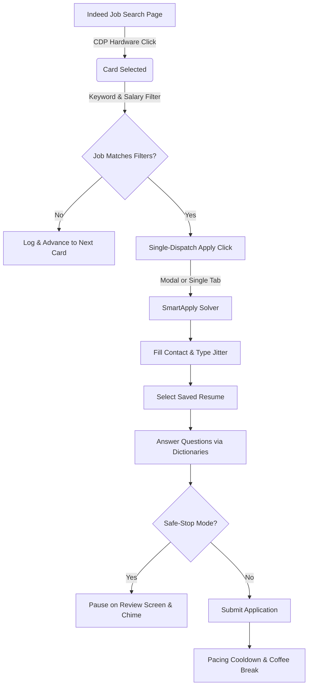

# Indeed Stealth SmartApply (Manifest V3) 🚀

[](https://developer.chrome.com/docs/extensions/mv3/intro/)
[](#-key-anti-detection--stealth-features)
[](#-single-dispatch--duplicate-tab-protection)
[](#step-6-ai-screening-assistant-setup-optional)
[](LICENSE)

An undetectable, human-paced, automated Chrome Extension engineered to safely search Indeed and complete multi-step **SmartApply / Indeed Apply** wizard applications without triggering Cloudflare Turnstile, DataDome bot checks, or React synthetic input anomalies.

---

## 📑 Table of Contents

- [⚡ Why Indeed Stealth SmartApply?](#-why-indeed-stealth-smartapply)
- [🛡️ Key Anti-Detection & Stealth Features](#️-key-anti-detection--stealth-features)
- [🔒 Single-Dispatch & Duplicate Tab Protection](#-single-dispatch--duplicate-tab-protection)
- [📦 Installation & Setup (5 Minutes)](#-installation--setup-5-minutes)
- [📘 Complete User Tutorial (Android Developer Example)](#-complete-user-tutorial-android-developer-example)
  - [Step 1: Set Up Your Candidate Profile](#step-1-set-up-your-candidate-profile)
  - [Step 2: Configure Skills & Custom Q&A Dictionaries (JSON)](#step-2-configure-skills--custom-qa-dictionaries-json)
  - [Step 3: Define Your Job Search Query](#step-3-define-your-job-search-query)
  - [Step 4: Smart Salary & Keyword Filtering](#step-4-smart-salary--keyword-filtering)
  - [Step 5: Safety Limits & Velocity Controls](#step-5-safety-limits--velocity-controls)
  - [Step 6: AI Screening Assistant Setup (Optional)](#step-6-ai-screening-assistant-setup-optional)
- [🎯 Running Your First Automation Session](#-running-your-first-automation-session)
- [🧪 Testing Locally (Without Live Indeed)](#-testing-locally-without-live-indeed)
- [🔔 Human Sentinel & Audio Chime](#-human-sentinel--audio-chime)
- [📁 Project Architecture & Workflow](#-project-architecture--workflow)
- [💡 Best Practices for Account Safety](#-best-practices-for-account-safety)
- [❓ Frequently Asked Questions (FAQ)](#-frequently-asked-questions-faq)
- [📄 Disclaimer & License](#-disclaimer--license)

---

## ⚡ Why Indeed Stealth SmartApply?

Most job application bots get detected and restricted quickly because they rely on synthetic JavaScript events (`element.click()`, fake keyboard events) and blitz through forms at superhuman speeds, often triggering multiple tabs or popup loops.

**Indeed Stealth SmartApply** was engineered from the ground up to mimic genuine human hardware interaction:
- **Physical clicks** generated directly by the browser's rendering engine via Chrome DevTools Protocol (`event.isTrusted === true`).
- **Natural typing jitter** with random per-character delays and prototype-level React 18 setter triggers.
- **Single-dispatch debouncing** that prevents double-clicks and guarantees exactly one tab/modal per employer.
- **Organic pacing** with realistic reading delays, inter-application breathers, and automatic coffee breaks.
- **Safe-Stop Mode** that lets you review every filled form before final submission.

---

## 🛡️ Key Anti-Detection & Stealth Features

1. **Trusted Hardware Clicks (`event.isTrusted === true`):**
   - Eliminates detectable synthetic `element.click()` calls.
   - Calculates randomized click coordinates within the central 60% of target buttons (`getBoundingClientRect()`).
   - Uses Chrome DevTools Protocol (`chrome.debugger` v1.3) via `Input.dispatchMouseEvent` with intermediate Bézier movements, press delays (40–110ms), and release holds (50–140ms).

2. **React 18+ Virtual DOM Setter Bypass:**
   - Bypasses React's synthetic event wrappers by calling native prototype property setters (`HTMLInputElement.prototype`, `HTMLTextAreaElement.prototype`, `HTMLSelectElement.prototype`).
   - Resets React's internal `_valueTracker` to ensure form state updates cleanly without validation failures.
   - Simulates human typing jitter (35ms–95ms per character) followed by bubbling `input`, `change`, and `blur` events.

3. **Cross-Origin Iframe Bridge:**
   - Seamlessly handles Indeed's cross-origin `smartapply.indeed.com` and `beta/indeedapply` iframes.
   - Translates coordinates from nested iframes to top-level window coordinates for accurate CDP hardware clicks.
   - Coordinates top-frame `scanner.js` and sub-frame `solver.js` via `background.js` messaging.

4. **Behavioral Throttling & Coffee Breaks:**
   - Form step delays: `2.2s` to `4.8s` (mimics human reading and clicking).
   - Inter-application gaps: `12s` to `25s` between job listings.
   - **Automatic Coffee Break:** After every 6 applications, pauses queue for `8 to 12 minutes` with a live countdown timer.
   - **Daily Application Cap:** Configurable daily quota (default: `25 applications/day`) persisted in local storage.

5. **Cloudflare & Screening Question Sentinel:**
   - Automatically handles Cloudflare Turnstile interactive checkboxes where possible.
   - If an unfamiliar mandatory employer question or challenge appears, transitions immediately to `PAUSED_FOR_HUMAN`, highlights the exact question with a pulsating neon-orange glow, plays an audible chime, and waits for you to review and click **Resume**.

---

## 🔒 Single-Dispatch & Duplicate Tab Protection

A common problem with web automation on job platforms is that clicking an "Apply now" button can trigger multi-burst clicks (e.g. physical click + synthetic event + child span click), causing Chrome to open **2 or 3 duplicate tabs for the same employer**.

Indeed Stealth SmartApply features a **Triple-Layer Tab Protection & External Redirect Engine**:
1. **Single-Dispatch Mutex (`isApplyingCurrentJob`):**
   - The scanner dispatches a single hardware click to the target button. Secondary synthetic clicks and child element clicks are strictly inhibited.
   - The scanner locks state until the application is either submitted or closed, preventing re-entrant card clicks.
2. **Background Tab Deduplicator:**
   - The background service worker actively intercepts newly created tabs.
   - If an application tab is already active and another tab attempts to open for the same job URL, the duplicate tab is immediately intercepted and closed.
3. **External Redirect Auto-Close & Auto-Advance:**
   - If an employer's apply button redirects away from Indeed to an external career portal (such as Workday, Greenhouse, Taleo, Lever, or employer custom site), the background worker detects the external domain, immediately **closes the external tab**, refocuses your Indeed search tab, and advances to the next job in your queue without getting stuck.

---

## 📦 Installation & Setup (5 Minutes)

### Prerequisites
- **Google Chrome** (or Chromium-based browser like Brave, Microsoft Edge, or Opera) version 100+.
- An active **Indeed account** logged in on your browser.
- A **saved or uploaded resume** on your Indeed profile (so Indeed can auto-select it during applications).

### Step-by-Step Installation

1. **Clone or Download the Repository:**
   ```bash
   git clone https://github.com/YtterStick/Indeed-Smart-Apply.git
   ```
   *(Or download and extract the ZIP file from GitHub).*

2. **Open Extensions in Chrome:**
   - In Chrome's address bar, navigate to:
     ```
     chrome://extensions/
     ```

3. **Enable Developer Mode:**
   - Toggle the **Developer mode** switch in the top-right corner of the page.

4. **Load the Extension:**
   - Click the **"Load unpacked"** button in the top-left corner.
   - Select the folder containing the project files (the folder containing `manifest.json`).

5. **Pin to Toolbar:**
   - Click the puzzle piece icon (Extensions) in your Chrome toolbar and click the pin icon next to **Indeed Stealth**.

---

## 📘 Complete User Tutorial (Android Developer Example)

Here is a practical, end-to-end example configured for an **Android / Mobile Developer** based in **Manila, Philippines / Remote**:

```
┌────────────────────────────────────────────────────────┐
│  ⚡ Indeed Stealth                         [ IDLE ]    │
│  Applications Today: 0 / 25   Session: 0   Cooldown: Ready
├────────────────────────────────────────────────────────┤
│  [ Controls ]   [ Profile ]   [ Filters ]   [ Settings ]│
└────────────────────────────────────────────────────────┘
```

---

### Step 1: Set Up Your Candidate Profile

Switch to the **Profile** tab:

1. **Candidate Identity:**
   - **Full Name:** `Mark / Your Full Name`
   - **Email Address:** `mark.dev@example.com`
   - **Phone Number:** `+63 917 123 4567` (or your local contact number)
   - **Location:** `Manila, Philippines or Remote`

2. **Compensation & Preferences:**
   - **Target Salary:** `80000`
   - **Currency:** `PHP (₱)` or `USD ($)`
   - **Frequency:** `Monthly` (for PHP) or `Annual / Yearly` (for USD)
   - **Notice Period:** `2 weeks` or `Immediately`

3. **Work Authorizations & Disclosures:**
   - ✅ **Legally authorized to work:** Checked
   - ⬜ **Requires visa sponsorship:** Unchecked (unless applying abroad)
   - ⬜ **Willing to relocate:** Unchecked (unless open to relocation)
   - ⬜ **Willing to work night / rotating shifts:** Check if open to US/EU shifts
   - ✅ **Valid driver's license:** Checked
   - ✅ **Consent to background check:** Checked

4. Click **"Save Profile"**.

---

### Step 2: Configure Skills & Custom Q&A Dictionaries (JSON)

Screening questions often ask for exact numbers of years or standard interview answers. The extension uses two JSON dictionaries:

#### 1. Experience by Skill (`profSkillsJson`)
Maps skill keywords to years of experience. Whenever a numeric screening question mentions one of these keywords, the bot inputs the configured number:

```json
{
  "kotlin": 4,
  "android": 4,
  "jetpack compose": 3,
  "java": 4,
  "react": 3,
  "javascript": 4,
  "git": 4
}
```

#### 2. Custom Screening Q&A Dictionary (`profCustomAnswersJson`)
Maps question keywords to your exact textual answers:

```json
{
  "highest level of education": "Bachelor's Degree in Computer Science",
  "authorized to work": "Yes",
  "notice period": "2 weeks",
  "driver license": "Yes",
  "gpa": "3.8",
  "commute": "Yes"
}
```

---

### Step 3: Define Your Job Search Query

Go to the **Controls** tab:

1. **Job Title or Keyword:** `Android Developer` (or `Kotlin Developer`, `Mobile Engineer`)
2. **Location / Remote:** `Remote` or `Manila, Philippines`
3. Click **"Navigate to Indeed Search"**. The active tab will immediately load Indeed search results.

---

### Step 4: Smart Salary & Keyword Filtering

Switch to the **Filters** tab and toggle **"Enable Keyword & Salary Filters"**:

1. **Salary Filter:**
   - **Minimum Salary:** `60000`
   - **Maximum Salary:** `150000`
   - **Pay Frequency:** `Per Month (Monthly)` (or `Per Year` for USD)
   - **Require Listed Salary:** Leave unchecked to also allow jobs with undisclosed compensation.

2. **Blacklist Keywords (Skip List):**
   ```
   commission only, unpaid, internship, senior lead, on-site only
   ```

3. **Must-Have Keywords (Optional):**
   ```
   android, kotlin, remote, mobile
   ```

4. Click **"Save Filters"**.

---

### Step 5: Safety Limits & Velocity Controls

Switch to the **Settings** tab:

1. **Daily Application Cap:** `25` applications per day (prevents account rate limits).
2. **Pacing Cooldown:** Built-in automatic **8 to 12-minute coffee break** every 6 applications.

---

### Step 6: AI Screening Assistant Setup (Optional)

Indeed Stealth SmartApply features an **Omni-Type AI Screening Engine** powered by Google Gemini:
1. **Radio Groups & Multiple Choice:** Extracts question context and allowed choices, prompts Gemini to select the single best matching answer based on your profile and skills, and clicks the target option.
2. **Dropdown `<select>` Menus:** Evaluates all `<option>` choices against candidate qualifications to make natural, accurate selections.
3. **Consents & Checkboxes:** Verifies agreements, background check terms, and matches multi-select skill checkmarks.
4. **Numeric Experience & Rates:** Calculates years of experience for unlisted skills or extracts hourly/monthly rates.
5. **Open-Ended Free Text & Textareas:** Generates concise, professional 1-2 sentence responses directly aligned with your experience.

**How to Enable AI:**
1. Obtain a free API key from [Google AI Studio](https://aistudio.google.com/).
2. Paste it into **Google Gemini API Key** under the **Settings** tab in the extension popup and click **Save Settings**.
3. Keys are stored strictly locally in your browser's private Chrome storage and never transmitted to any third-party server.

---

## 🎯 Running Your First Automation Session

### Safe-Stop Mode (Review Screen Pause)

On your first run, keep **Safe-Stop Mode** checked on the Controls tab:

1. Navigate to Indeed and verify search results are showing.
2. Click **"Start Auto-Apply (Review Mode)"**.
3. The bot will:
   - Perform a single trusted CDP hardware click on the job card.
   - Evaluate salary and keywords.
   - Click "Apply now" once without opening duplicate tabs.
   - Fill candidate contact details with human typing jitter.
   - Select your saved Indeed resume.
   - Fill screening questions.
   - **Pause at the Review screen** and play a chime.
4. Verify all information on screen. You can submit manually, or uncheck Safe-Stop Mode to let the bot auto-submit subsequent applications!

---

## 🧪 Testing Locally (Without Live Indeed)

Before running on live job sites, test all interactions locally using the built-in simulator:

1. Open [`test/mock-indeed-wizard.html`](test/mock-indeed-wizard.html) in Chrome.
2. Open the extension popup and click **"Start Auto-Apply"**.
3. Watch the hardware click telemetry panel verify:
   - `isTrusted: true (CDP Physical)`
   - Contact form auto-fill with typing jitter
   - Resume selection
   - Screening questions answered
   - Safe-Stop mode paused at the final Review screen
4. Test Sentinel triggers using **"🚨 Inject Cloudflare Turnstile"** or **"⚠️ Inject Form Error Banner"** to observe immediate pause, orange highlight, and audible chime.

---

## 🔔 Human Sentinel & Audio Chime

When the bot encounters:
- An unanswered mandatory question
- A CAPTCHA or verification challenge
- A form validation error

It will:
1. Immediately pause (`PAUSED_FOR_HUMAN`).
2. Highlight the element with a pulsating neon-orange glow.
3. Play an alert chime via the Web Audio API.
4. Send a desktop notification.

Simply complete the highlighted question in your tab, then click **Resume** in the popup to continue.

---

## 📁 Project Architecture & Workflow



### File Structure
```
indeed-automation/
├── manifest.json              # Chrome MV3 manifest (permissions, content scripts, metadata)
├── background.js              # Service Worker (CDP hardware clicks, tab deduplication, Gemini AI)
├── utils/
│   └── dom-stealth.js         # React 18 setter bypass, typing simulation, resilient selectors, chime
├── content/
│   ├── scanner.js             # Top-frame search scanner, single-click apply, job filtering
│   └── solver.js              # SmartApply wizard solver, step detection, sentinel triggers
├── popup/
│   ├── popup.html             # Cyber-sleek dark dashboard UI with glassmorphism tabs
│   ├── popup.css              # Cyber-clean styles, status badges, glowing indicators
│   └── popup.js               # Dashboard state sync, JSON validation, live telemetry stream
├── test/
│   └── mock-indeed-wizard.html# Standalone React-controlled local test simulator
├── icons/                     # Extension icons (16px, 48px, 128px) & generator
└── README.md                  # Complete documentation and tutorial
```

---

## 💡 Best Practices for Account Safety

- **Keep Daily Cap Realistic:** We recommend keeping your daily cap at **20–30 applications per day**. Real human job seekers rarely submit 100+ applications in a single day.
- **Let Coffee Breaks Finish:** Do not manually skip the 8–12 minute coffee breaks. Indeed monitors application velocity, and natural breaks keep your session looking organic.
- **Maintain an Uploaded Resume on Indeed:** Having a saved resume on your Indeed profile ensures the bot can select it via radio buttons without needing to upload files from your local disk.
- **Check Your Activity Log:** Keep an eye on the **Activity Stream** on the Controls tab to see real-time step progress and filter decisions.

---

## ❓ Frequently Asked Questions (FAQ)

#### Q: Why was it opening 3 tabs before, and how is it fixed?
**A:** Previously, the apply trigger was firing multiple clicks in rapid succession (CDP click + synthetic events + child span click + background watchdog timer). This has been completely replaced with a **Single-Dispatch Mutex** in `scanner.js` and an active **Tab Deduplicator** in `background.js` that intercepts and closes any duplicate tabs.

#### Q: Does this work on international Indeed domains?
**A:** Yes! The extension matches `*://*.indeed.com/*` and supports local country subdomains (e.g. `ph.indeed.com`, `ca.indeed.com`, `uk.indeed.com`, etc.). It also normalizes salary amounts across multiple currencies ($ USD, ₱ PHP, € EUR, £ GBP, CAD, AUD, SGD, INR).

#### Q: What if an employer asks for a fresh resume upload?
**A:** If you have a resume saved on your Indeed account, Indeed provides a radio button to select your saved resume, which the bot automatically selects. If an employer explicitly demands a fresh file upload, the Sentinel will pause and notify you to choose your file.

#### Q: Where are my profile and settings stored?
**A:** Everything is saved directly in your browser using Chrome's local storage API (`chrome.storage.local`). Your personal details, credentials, and API keys never leave your computer.

---

## 📄 Disclaimer & License

**Disclaimer:** This software is developed for educational and personal workflow efficiency purposes. Users are responsible for complying with Indeed's Terms of Service and local job application regulations. The authors are not responsible for any account restrictions resulting from misuse.

Distributed under the **MIT License**. See `LICENSE` for more information.
